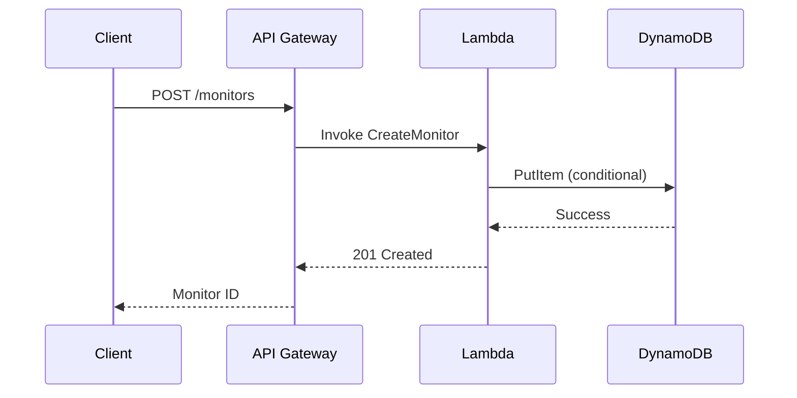
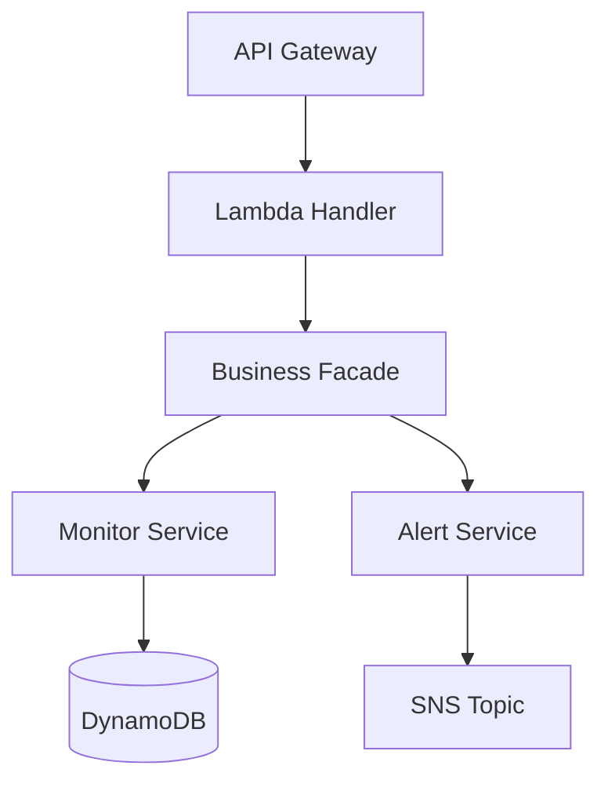

# Writing a Kiro design document

A Kiro design document, `design.md`, is the second of the three files of a Kiro IDE spec for one
feature. It decomposes the system-level design into a low-level design for this feature only,
covering the components its requirements need, in the six sections Kiro expects. In Kiro's
spec-driven development it is the blueprint for the task list.

It follows the `kiro-requirements` guide in the fuse library
(`fuse/flow/library/artifacts/kiro-requirements/guide.md` in the fuse-konductor clone), whose
`requirements.md` it designs for.

## Inputs

Use the paths the step or its consumed artifacts give you, or the documents the request names;
search only for what they do not name. Use what is available; at minimum you need
`requirements.md` and a system design.

1. **`requirements.md`** for the feature, in the feature's spec directory: EARS requirements and
   their acceptance criteria.
2. **The system design**, written with the `design` guide in the fuse library
   (`fuse/flow/library/artifacts/design/guide.md`): architecture, component diagrams, data flow.
3. **The threat model**, written with the `threat-model` guide in the fuse library
   (`fuse/flow/library/artifacts/threat-model/guide.md`): threats, security controls, trust
   boundaries.
4. **The DynamoDB design**, from the `dynamodb-design` skill: table schemas, key design, global
   secondary indexes, access patterns.
5. **The API model**, written with the `api-model` guide in the fuse library
   (`fuse/flow/library/artifacts/api-model/guide.md`): Smithy service definitions, operation
   signatures, input and output shapes.

## Where the file goes

Write one `design.md` for one feature, into the same spec directory as its `requirements.md`. The
step's artifact path decides it: the spec directory is the folder of that path. When the step or
its caller names a spec directory instead (some callers call it `spec_dir`), read and write there.
Only when neither is given, use the Kiro IDE default, `.kiro/specs/<feature>/`.

```
.kiro/specs/
├── network-monitoring/
│   ├── requirements.md
│   └── design.md
├── vpc-analyzer/
│   ├── requirements.md
│   └── design.md
```

## The six required sections

Every `design.md` MUST contain exactly these six sections, in this order.

### 1. Overview

- What the feature does and why, in one or two paragraphs.
- Which requirements from `requirements.md` this design addresses, as a traceability note.
- The key design decisions and their rationale.
- The scope boundaries: what is and is not included.

### 2. Architecture

- A component diagram of how this feature's components interact.
- The integration points with existing system components.
- The data flow for the primary use case.
- At least one diagram, in the tool the house rules name. Without one, use Mermaid, which Kiro
  renders inline in `design.md`; the examples below use it.

Example sequence diagram:

````markdown

````

Example architecture diagram:

````markdown

````

### 3. Components and Interfaces

For each component: its purpose and responsibility, its public interface as typed function
signatures, its dependencies on other components, and its configuration parameters.

```typescript
// MonitorService - manages monitor lifecycle
interface MonitorService {
  createMonitor(input: CreateMonitorInput): Promise<Monitor>;
  getMonitor(monitorId: string): Promise<Monitor | null>;
  updateMonitor(monitorId: string, input: UpdateMonitorInput): Promise<Monitor>;
  deleteMonitor(monitorId: string): Promise<void>;
  listMonitors(filters: MonitorFilters): Promise<PaginatedResult<Monitor>>;
}
```

### 4. Data Models

- The table design (partition key, sort key, secondary indexes) when there is one.
- Typed interfaces for the domain entities.
- The request and response shapes of the API operations.
- The relationships between entities.

```typescript
interface Monitor {
  monitorId: string; // PK: MONITOR#<id>
  accountId: string; // SK: ACCOUNT#<id>
  name: string;
  status: 'ACTIVE' | 'PAUSED' | 'ERROR';
  config: MonitorConfig;
  createdAt: string; // ISO 8601
  updatedAt: string; // ISO 8601
}
```

### 5. Error Handling

For each error scenario: what triggers it, how the system responds, what the user sees, and the
recovery strategy (retry, fallback, escalate). Cover at least input validation (400),
authentication and authorization failures (401, 403), resource not found (404), conflicts and
race conditions (409), downstream service failures (502, 503) and throttling (429).

### 6. Testing Strategy

- Unit test scope: what to mock and what to test in isolation.
- Integration test scope: which component interactions to verify.
- End-to-end test scope: the critical user journeys to validate.
- Test data: fixtures, factories, seed data.

```
Unit Tests:
- MonitorService.createMonitor: validates input, calls repository, returns monitor
- MonitorService.createMonitor: throws ConflictError on duplicate name

Integration Tests:
- POST /monitors → creates monitor in DynamoDB → returns 201
- POST /monitors with duplicate name → returns 409

E2E Tests:
- Create monitor → verify in dashboard → receive first alert
```

## Decomposition rules

**Requirement mapping.** Each requirement in `requirements.md` maps to at least one component. List
the addressed requirements in the Overview. When the design cannot address a requirement, say so
explicitly.

**Feature scope.** Include only the components directly involved in this feature. Reference shared
components, such as authentication middleware or logging, without repeating their design: "Uses
the shared AuthMiddleware (see system design) for JWT validation."

**Cross-feature references.** When this feature depends on another feature's components, reference
that feature's `design.md`, for example "Depends on the Alert entity from
`.kiro/specs/alert-management/design.md`", and extend it rather than copying it.

**Granularity.** A developer who reads only this `design.md` and its `requirements.md` should know
what to build, and the tasks should follow from it. Aim for 100 to 300 lines; split a feature that
needs more into sub-features.

**Diagrams.** Use sequence diagrams for the key request and response flows, including asynchronous
processing; architecture diagrams (`graph TD` or `graph LR`) for component relationships; state
diagrams for entities with a lifecycle (for example ACTIVE, PAUSED, ERROR); and entity
relationship diagrams for complex data. Keep one diagram per concept: two or three focused
diagrams are easier to read than one large one.

## Method

1. **Read `requirements.md`.** Extract every requirement and its acceptance criteria, the feature
   scope and personas, and any quality requirements or constraints in the introduction.
2. **Read the system design** and whichever of the threat model, the DynamoDB design and the API
   model are available.
3. **Find the feature's components.** Map each requirement to the components that implement it,
   trace the data flow of the primary use case, note the shared components the feature uses but
   does not own, and list the integration points with external services and other features.
4. **Write the six sections.** Typed signatures in Components and Interfaces, typed fields in Data
   Models, the error scenarios from the acceptance criteria plus the standard errors above, and
   concrete test cases at each level.
5. **Check it** against the checks below before you present it.

## Quality checks

**CRITICAL (must fix before done):**

- Any of the six sections missing: Overview, Architecture, Components and Interfaces, Data Models,
  Error Handling, Testing Strategy.
- A requirement in `requirements.md` that traces to no component.
- Component interfaces without typed function signatures.
- Data models without field types.
- `design.md` not in the same spec directory as its `requirements.md`.

**IMPORTANT (should fix):**

- No diagram, in the house rules' diagram tool or else Mermaid.
- Missing error scenarios for operations that call external services or accept user input.
- A testing strategy without one of the three levels: unit, integration, end-to-end.
- Shared components designed again in full instead of referenced.
- More than 300 lines without a split into sub-features.

**SUGGESTION:**

- The rationale for design decisions: why this approach over the alternatives.
- State diagrams for entities with lifecycle states.
- Performance considerations: expected latency and throughput.
- A Future Considerations section for known extensions.

Report the findings in the order CRITICAL, IMPORTANT, SUGGESTION. Fix every CRITICAL finding
before you present the document, and present the rest with it, unless the step says how to handle
them.
